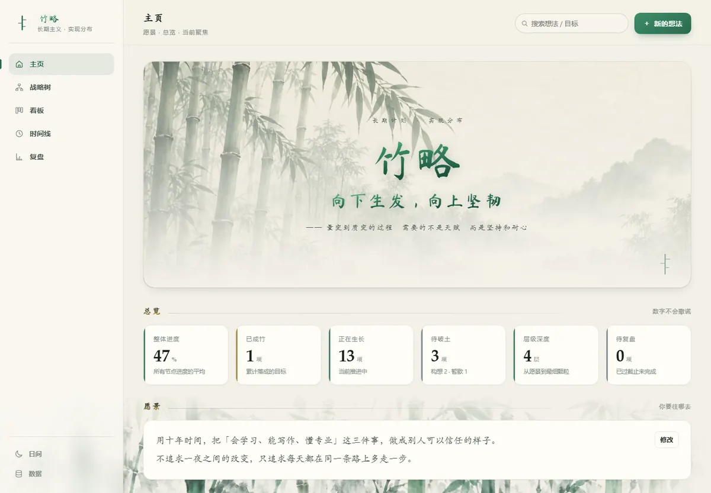
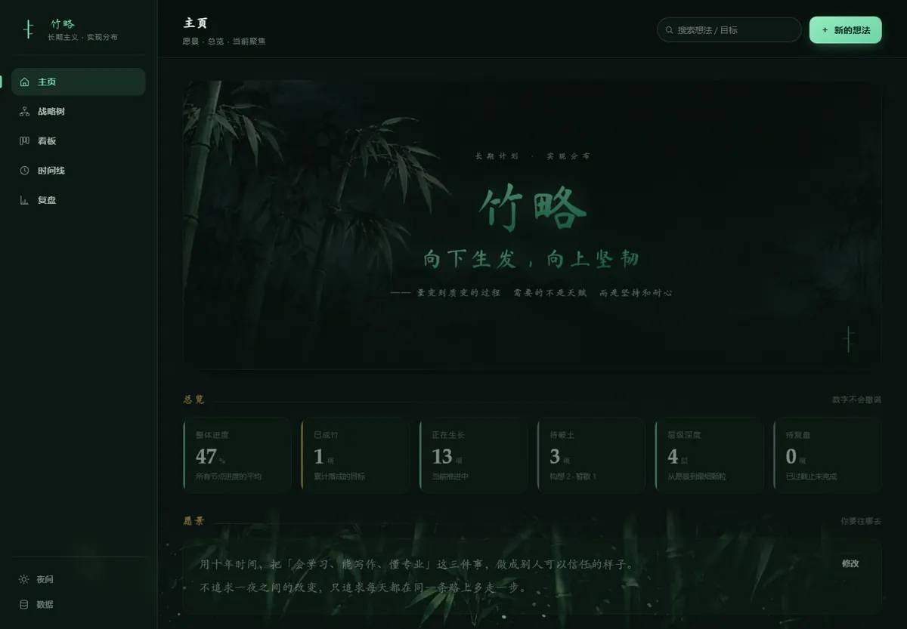

# 竹略 · 长期计划与实现分布

> 向下生发，向上坚韧

一个把「长期愿景」拆成「可执行小块」的个人战略系统。不是待办清单，是一棵能一直往下长、也能随时回头看清结构的树。

<p align="center">
  
</p>
<p align="center">
  
</p>

**在线使用**：https://123xzw999.github.io/bamboo-plan/

---

## 它解决什么问题

长期目标失败，通常不是因为懒，而是因为**结构不清**：
「今年要提升自己」这种目标，没法执行，也没法复盘。
竹略强迫你把每件事一层层拆到「今天能动手」的颗粒度，同时保留它和顶层愿景的血缘关系。

层级不设上限：**愿景 → 战略 → 阶段 → 任务 → 子任务 → 细节 → ……**

## 功能

| 视图 | 做什么 |
| --- | --- |
| **主页** | 愿景、总体进度、当前聚焦（同时只推进三件）、最近变动 |
| **战略树** | 无限层级下钻，节点可展开/收起/上下移动，一眼看清整棵结构 |
| **看板** | 四个生长阶段：构想 · 生长 · 暂歇 · 成竹。**拖动卡片即改状态** |
| **时间线** | 甘特视图，目标在时间轴上的分布与重叠，标出今天 |
| **复盘** | 状态分布环图、各层推进度、关键指标、复盘日志 |
| **数据** | JSON 备份/恢复、导出 Markdown 战略书、载入示例、清空 |

其它：全文搜索（`Ctrl/⌘ + K`）、日/夜主题、节点步骤清单（勾选自动算进度）、逾期提醒、响应式（手机可用）。

## 设计说明

**配色**：日间是宣纸米白 + 墨色，夜间是深墨竹青。
主色「翠墨绿」用于大标题，辅色「黑金」用于小标题与具体内容。

**艺术字**：大标题/标语用毛笔楷书（Ma Shan Zheng 子集化后自托管），
通过 `background-clip: text` + 渐变做出翠墨绿质感；
小标题用宋楷系统字体叠黑金渐变。

**竹影**：底部竹影是把一张水墨竹图**切成三段互相搭接**的窗口，
每段用不同周期/相位/幅度独立摆动 —— 整片竹林因此有层次地随风起伏，而不是整块平移。
亮色用白底墨竹、暗色用夜竹，出图时已把底抠成 alpha，所以能自然叠在任意底色上。

**无障碍**：尊重 `prefers-reduced-motion`（关掉全部动画）；键盘可完成全部操作；`Esc` 关闭弹层。

## 本地使用

零依赖，不需要构建。任选一种：

```bash
# 方式一：直接双击 index.html

# 方式二：起个本地服务（推荐，localStorage 行为更接近线上）
python -m http.server 8080
# 然后打开 http://127.0.0.1:8080/
```

**登录**：默认账号 `123456`，密码 `xiaoxiong666`（源码里只存摘要，不存明文）。

> ⚠️ 这是**前端门禁**，作用是「防误入」，不是真正的鉴权 —— 纯静态站任何人都能绕过。
> 别把真正的机密放进来。

## 数据

全部内容存在**浏览器 localStorage**，不上传任何服务器。
换设备 / 清缓存前，请到「数据」面板导出 JSON 备份。

导出 Markdown 会生成一份带层级缩进、复选框、日期与标签的战略书，可直接打印或粘进笔记软件。

## 目录结构

```
bamboo-plan/
├── index.html
├── css/style.css          # 设计令牌 + 全部样式
├── js/
│   ├── store.js           # 数据模型、持久化、导入导出、示例数据
│   ├── auth.js            # 前端门禁（FNV-1a 双轮摘要）
│   ├── views.js           # 五个视图的纯函数渲染器
│   └── app.js             # 路由、主题、事件、竹影、拖拽
├── assets/                # 竹子素材（WebP）+ 子集化书法字体
└── _tools/                # 素材与字体的生成脚本 + 自动化验收脚本
```

## 素材与字体怎么来的

`_tools/` 里是可复现的生成脚本（不参与线上运行）：

| 脚本 | 作用 |
| --- | --- |
| `compress.py` | 竹子原图 → WebP，10.07MB → 0.75MB |
| `keyout.py` | 白底/黑底 → alpha 通道（按亮度当墨水浓度） |
| `subset_font.py` | 5.9k 字书法字体 → 只保留站点用到的 757 字，2.58MB → 271KB |
| `mkpage.js` | 从 index.html 生成带探针的临时验收页 |
| `verify.js` + `runverify.py` | 52 项端到端断言（门禁、五视图、拖拽、增删改、持久化、字体…） |
| `shot.js` + `shots.py` | 逐页截图，明暗双主题 + 窄屏，用于肉眼验收 |

```bash
# 重新生成素材
python _tools/keyout.py
python _tools/subset_font.py

# 跑一遍验收
node _tools/mkpage.js build
python _tools/runverify.py
```

---

向下生发，向上坚韧。
